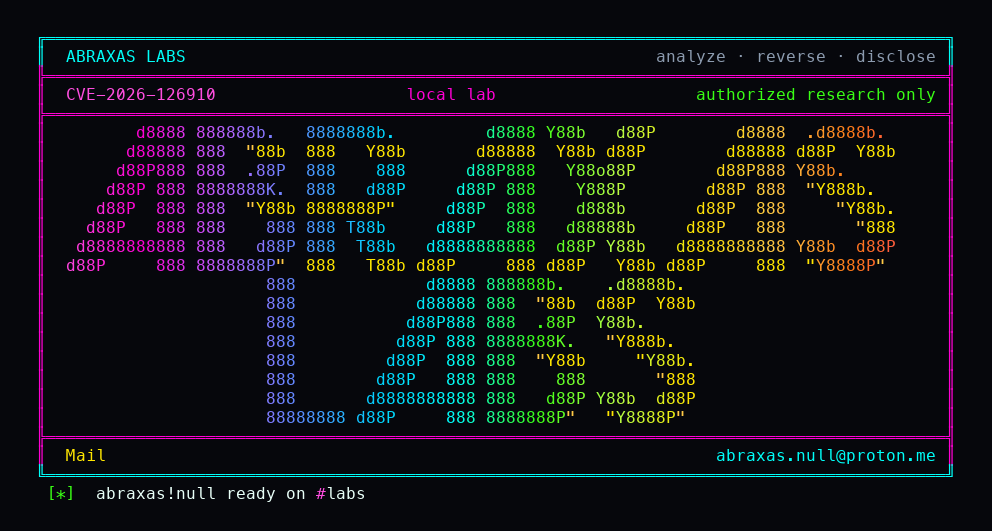

<p align="center">
  
</p>

# chrome-v8-maglev-literal-stale

Chrome's JavaScript engine has a fast compiler called Maglev. It looked at a
property on `Object.prototype`, decided the answer was `"TRUE"`, and burned
that into optimized code. Then the page created an object (or an array). That
literal write kicked the prototype out of dictionary mode and onto a new map.
Maglev never marked the literal as a write, so it kept using the old load.
The next read came back `"WRONG"`.

That is type confusion. Google shipped it as CVE-2026-126910, High, "arbitrary
code inside the sandbox," fixed in Chrome 157.0.8103.78 on 11 November 2026.
This pack is the stale load, not a shell.

**Class:** Type confusion (CWE-843)
**Reach:** Remote, crafted web content

| | |
|---|---|
| ID | [CVE-2026-126910](https://www.cve.org/CVERecord?id=CVE-2026-126910) |
| Class | **Type confusion** (CWE-843) |
| Reach | **Remote** (crafted HTML) |
| Product | [Google Chrome](https://www.google.com/chrome/) / V8 Maglev |
| Affected | Chrome before 157.0.8103.78 (Windows/Mac 157.0.8103.78/.79, Linux 157.0.8103.78) |
| Fixed | Chrome 157.0.8103.78, V8 CL 8668740 (`I3298cf355d6751a71f1c8e4f42a2797f2c4acbd7`), M157 cherry-pick 8753123 |
| Chrome rating | High |
| Auth | none |
| License | [GNU Affero GPL v3.0](LICENSE) |
| Lab | local Docker, linux-arm64 Chrome for Testing |

## What an attacker can do

| Method | Sink | Result |
|---|---|---|
| Maglev-compile a load of `Object.prototype.x1`, then `CreateObjectLiteral` / `CreateArrayLiteral` | Maglev IR missing `CanWrite` on those literals | **Lab-proven:** vulnerable `157.0.8103.50` returns `"WRONG"` for both object and array cases; patched `157.0.8103.78` deopts and returns `"TRUE"` |
| Same map transition on a more interesting hidden class | typed load of the wrong representation | **Inferred from the patch.** Maglev treated a write as a pure create. Wrong map means wrong typed load |
| Turn the type confusion into renderer RCE | V8 heap | **Not attempted.** No forged pointers, no shell. Google rates the class as code exec inside the sandbox |
| Browser-process compromise | sandbox escape | **Closed for this bug.** This is renderer/V8 only |

`%OptimizeMaglevOnNextCall` in the lab is the in-tree regress harness (`regress-575525282-2.js` / `-3.js`). A real page would wait for Maglev's normal tier-up.

## Why the literal was a write

`CreateObjectLiteral` and `CreateArrayLiteral` can put a prototype into fast
mode, which changes its map. Maglev IR listed them as if they could not write.
CL 8668740 (Marja Hölttä, reviewed by Darius Mercadier, V8 main@{#111225})
marks those nodes `CanWrite`. After the fix, Maglev bails when the prototype
map changes, and the load sees `"TRUE"` again.

Chromium issue 574059463 stays restricted. The patch and the mjsunit files are
public.

## The lab

Two Chrome for Testing builds, headless, `--js-flags=--allow-natives-syntax --maglev --no-turbofan`.

1. Warm `h` on a dictionary-mode prototype so Maglev sees `x1 === "TRUE"`.
2. Maglev-compile `h`.
3. Fire `CreateObjectLiteral` or `CreateArrayLiteral` (the write).
4. Read `obj.x1`.

Vulnerable pin: Maglev stays optimized (`status 25`), value is `"WRONG"`.
Patched pin: Maglev deopts (`status 65`), value is `"TRUE"`.

```bash
python3 chrome-v8-maglev-literal-stale-Abraxas-Labs.py
```

or:

```bash
cd lab && ./run.sh
```

Last proven line:

```
SUCCESS CVE-2026-126910 maglev-literal-stale-load cases=object,array CVE-2026-126910-TYPECONF-WITNESS
```

Image `cve-2026-126910:lab`, compose project `cve126910`, loopback `127.0.0.1:18630`. Host is linux-arm64 Docker (Apple Silicon).

| File | Purpose |
|---|---|
| `lab/poc.html` | object and array cases from the V8 regress files |
| `lab/poc.py` | headed-off CFT, Maglev flags, differential `WRONG` vs `TRUE` |
| `lab/cve-2026-126910.patch` | V8 CL 8668740 as mailed |

Abraxas Labs
abraxas.null@proton.me
